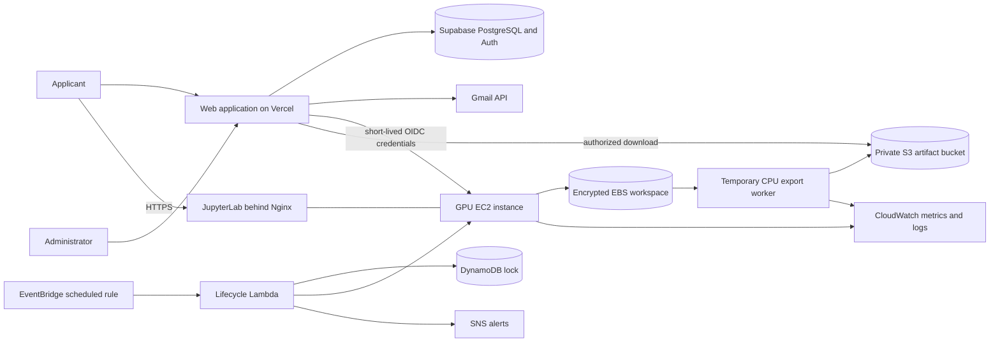

# System architecture

DCS HPC provides a proposal and review process for allocating time-limited research GPU access. The website is hosted separately from ephemeral cloud compute. An admin reviews applications and schedules sessions; the applicant uses an access token to enter the portal and start JupyterLab.

## Component responsibilities

| Component | Role |
| --- | --- |
| Next.js on Vercel | Public site, application, admin dashboard and server routes |
| Supabase PostgreSQL and Auth | Application data, schedule, audit records and administrator authentication |
| Google OAuth and Gmail API | Admin sign-in and transactional messages; configured as distinct integrations |
| EC2 and JupyterLab | A dedicated, short-lived research environment |
| EBS and S3 | Encrypted workspace disk and temporary downloadable archive |
| EventBridge, Lambda and DynamoDB | Deadline reconciliation, export orchestration and concurrency control |
| CloudWatch and SNS | Metrics, access and lifecycle logs, and failure notifications |
| IAM, networking and DNS | Role-based access, network controls and HTTPS lab access |
| CloudFormation | Reproducible provisioning of the lifecycle stack |

## Trust boundaries

The website authenticates administrators with Google through Supabase. Applicants receive a time-limited access grant. Vercel uses short-lived OIDC federation to call AWS; AWS compute and controller processes use their own roles. The lab is accessed over HTTPS and is separate from the portal. Student workspace exports are private and available only through the authorized portal.

## Data lifecycle

Application and scheduling records live in PostgreSQL. During an allocation, user files are stored on encrypted EBS. At the deadline, the GPU is stopped and a separate CPU worker mounts the original disk read-only, creates and verifies an archive in S3, then cleanup removes temporary cloud resources when safe. Certain dataset and cache paths are intentionally excluded; consult the application owner's current policy before relying on an export. A workspace archive is **not** a database backup.
