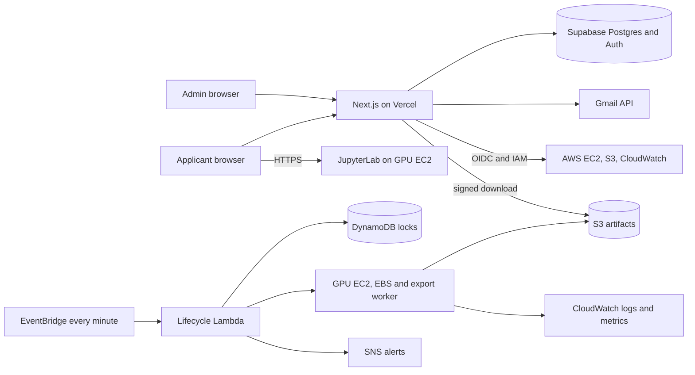

# Architecture and repository map

The portal accepts proposals for currently free research compute. An admin reviews an application, proposes a time and grants access after confirmation. EC2 hosts JupyterLab for the allocation. At expiry, an independent controller stops the GPU and exports eligible workspace files to S3 using a cheaper worker; the portal offers temporary downloads.

Vercel runs web routes; it does not host Jupyter kernels or the export process. A shared Elastic IP and wildcard lab DNS route Jupyter traffic directly to the GPU host. The web domain and lab subdomains serve different purposes.

## Stack

- Next.js App Router, React, JavaScript, CSS and Lucide icons.
- Supabase PostgreSQL, Supabase Auth with Google sign-in, database functions and row-level security.
- Gmail API with OAuth for transactional email; Google Drive links for proposal documents.
- AWS EC2, EBS, S3, Lambda, EventBridge, DynamoDB, SNS, CloudWatch, IAM and CloudFormation. Vercel uses OIDC for production AWS access.
- Python workers, JupyterLab, Nginx, Let's Encrypt and CloudWatch Agent on AWS instances.

## Source map

| Location | Responsibility |
| --- | --- |
| `src/app/landing`, `apply`, `revise`, `confirm`, `compute`, `admin` | Public, applicant and admin pages |
| `src/app/api` | Application, auth, admin, session and download routes |
| `src/components` | Forms, dashboard, monitoring, clock and export progress |
| `src/lib/server.js`, `validation.mjs` | Server helpers, permissions, validation and standing |
| `src/lib/aws.js` | AWS calls, GPU launch, bootstrap and artifact access |
| `src/lib/monitoring*` | Instance telemetry and access evidence |
| `src/lib/mail.js`, `portal-email-templates.mjs` | Gmail sending and email templates |
| `worker/lifecycle.yaml` | CloudFormation lifecycle infrastructure |
| `worker/isolated_controller.py`, `isolated_worker.py`, `export_workspace.py` | Reconciliation, worker bootstrap and ZIP export |
| `supabase/migrations` | Incremental changes following the initial schema |
| `tests`, `worker/test_*.py` | JavaScript and Python tests |
| `monitoring-iam.json` | Monitoring policy examples; not a complete live IAM export |

The original schema, migrations, live external settings and deployed versions must be considered together. No single file represents the entire system.

## Pages and API endpoints

| Path | Purpose |
| --- | --- |
| `/landing`, `/apply` | Program introduction and application form |
| `/revise`, `/confirm` | Applicant revision and explicit schedule response |
| `/compute` | Token redemption, session access and research files |
| `/admin`, `/admin/applications/[id]` | Admin overview and application review |
| `/auth/callback` | Supabase Google sign-in callback |
| `/api/applications`, `/api/applications/[id]/revise` | Submit and revise applications |
| `/api/confirm` | Schedule confirmation/decline handling |
| `/api/auth/google`, `/api/auth/logout` | Admin sign-in initiation and logout |
| `/api/admin/applications/[id]`, `/api/admin/monitoring` | Administrative decisions and monitoring |
| `/api/portal/redeem`, `/api/portal/logout` | Applicant token exchange and logout |
| `/api/portal/compute/session`, `/api/portal/download` | Session launch/status and authorized artifact download |
| `/api/dev/login-preview`, `/api/dev/portal-session` | Development-only preview helpers, unavailable in production |

The endpoint implementations enforce their own methods, validation and authentication. Their existence is not a promise that a request is allowed without a valid session or token.
